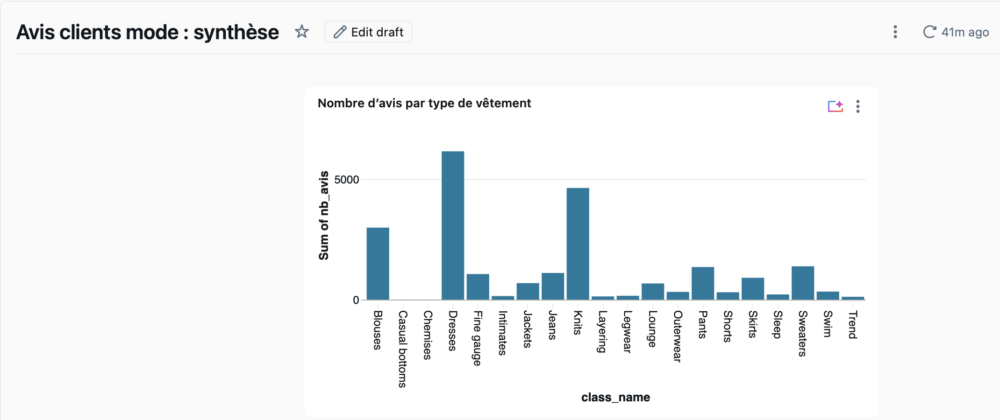
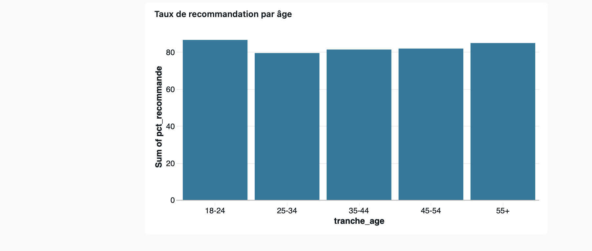
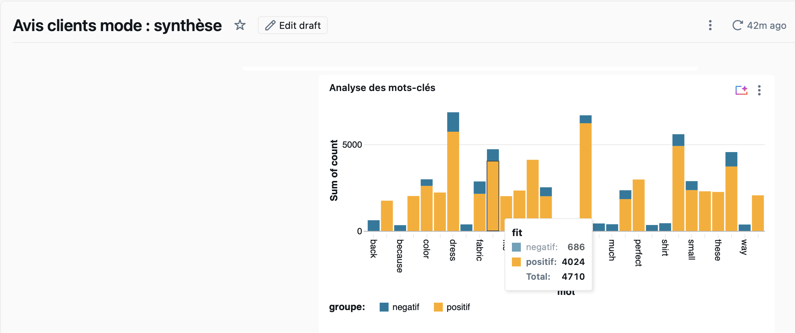

# databricks-avis-mode
# Analyse d'Avis Clients Mode : Pipeline Databricks et NLP

## Contexte et Objectif
Ce projet présente la mise en place d'un pipeline de données complet de bout en bout, depuis l'ingestion brute jusqu'à la restitution sous forme de tableau de bord. L'objectif est d'analyser les avis clients sur des articles de mode (jeu de données public Kaggle : Women's E-Commerce Clothing Reviews) pour en extraire des indicateurs métiers grâce au traitement automatique du langage naturel (TAL / NLP).

## Architecture du Pipeline (PySpark)
Le traitement suit l'architecture médaillon sous Databricks :

- Couche Bronze (Brute) : Importation initiale de 23 486 avis depuis le fichier CSV et normalisation des noms de colonnes.
- Couche Silver (Nettoyée) : Typage des variables, suppression des valeurs manquantes et des doublons, puis création des colonnes dérivées (review_length, word_count). Conservation de 22 639 avis qualifiés.
- Couche Gold (Agrégée) : Création de 3 tables orientées métier pour l'alimentation du dashboard :
  1. avis_gold_categories : Volume et notes par catégorie de produit.
  2. avis_gold_ages : Taux de recommandation par tranche d'âge.
  3. avis_gold_mots : Extraction des mots-clés les plus fréquents (hors stop-words) selon la polarité de l'avis.

## Observations Linguistiques (NLP)
L'analyse fréquentielle montre une nette distinction sémantique selon la note attribuée par l'utilisateur :
- Avis Positifs (Note = 5) : Le vocabulaire s'articule autour de l'expérience au porté et du confort (flattering, soft, comfortable, perfect, love).
- Avis Négatifs (Note <= 2) : Le champ lexical se concentre sur les aspects matériels et les défauts physiques du produit (fabric, material, quality, size).

## Tableau de Bord (Databricks Dashboard)
Un tableau de bord interactif permet de synthétiser l'ensemble de ces informations :

## Prochaines étapes et axes d'amélioration
- NLP Avancé : Remplacer le comptage de mots par un modèle de classification de sentiments ou un appel d'API LLM pour traiter les nuances complexes (sarcasme, analyse par aspects).
- Interface "Talk to my Data" : Intégrer un agent conversationnel pour permettre la requête en langage naturel sur le jeu de données.
- Orchestration : Automatiser l'exécution du pipeline via Databricks Workflows ou Apache Airflow.
